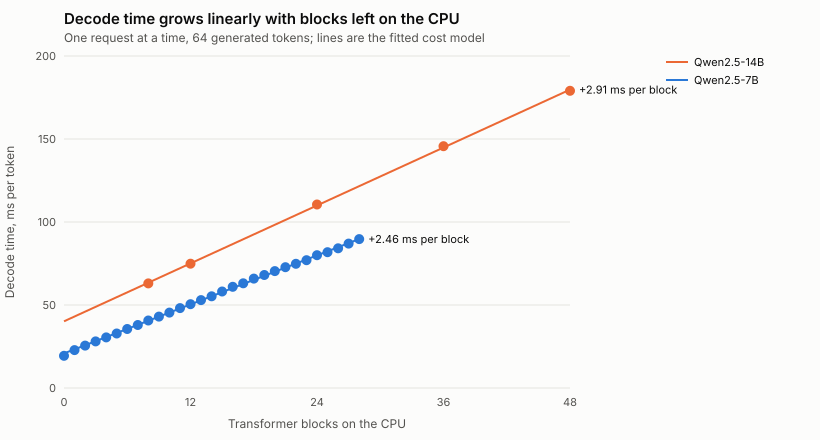
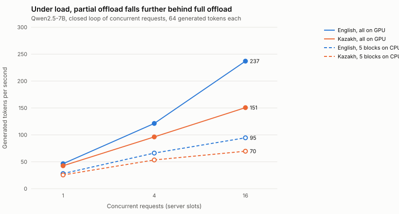
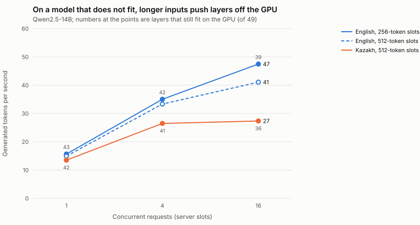

# Current research report

**Status: 16 November 2026.** Stage 1 (one laptop, native Linux, llama.cpp) is measured and analysed. Stage 2 (a server with vLLM and NEO) has not started. The first stage of the project, measured under WSL with the original research questions, is kept as the [October report](report-2026-10-wsl.md).

## Main findings

1. **When the model fits in VRAM, splitting it between CPU and GPU never beats GPU-only.** On Qwen2.5-7B every transformer block moved to the CPU adds about 2.4 ms per generated token; speed falls monotonically from 51.5 to 10.3 tokens per second across all 30 placements, with no optimum in between.
2. **The loss is explained by a three-term cost model** (R² ≥ 0.9995): a constant cost per CPU block, a small one-off handoff, and an expensive output layer. The model reproduced within about 1% in a second session and has the same form on Qwen2.5-14B.
3. **Under concurrent requests partial offload falls further behind.** With five blocks on the CPU the 7B model delivers 60% of GPU-only throughput at one request and 40% at sixteen.
4. **When the model does not fit, the hybrid is the only way to use the GPU, and it pays.** Qwen2.5-14B loads with at most 41 of 49 layers in 8 GB and then generates 3.1 times faster than the CPU alone. This is a comparison with CPU-only: a GPU-only run of this model does not exist on this machine.
5. **Language shifts the best configuration only in that memory-bound, concurrent regime, and only through token length.** Kazakh inputs need twice the context per slot, which pushes up to three more layers off the GPU. English gains 27–36% from 4 to 16 slots; Kazakh gains about 4%, inside the spread between rounds, while its latency grows nearly fourfold.
6. **With one request at a time, input length is enough.** English and Chinese have the same mean token count and the same latency (within 0.6%) in every placement.

None of these results shows a hybrid outperforming GPU-only on the same model. The laptop cannot show that; see [why APEX is faster](#why-apex-gains-from-the-cpu-and-this-setup-does-not).

## Research questions

The questions were reformulated on 14 November 2026 after the first stage and approved by the course supervisor.

- **RQ1:** Under which conditions does CPU+GPU execution outperform GPU-only, and does the request language shift that boundary?
- **RQ2:** Is a policy that knows only the sequence length sufficient to choose the configuration?

The original questions asked whether language changes the best configuration at equal token length. The October report answered that with a restricted negative finding, and showed why the design could not find more: memory was never scarce, and a fixed 64-token output hid the cost of longer inputs.

## Setup

- AMD Ryzen 7 7435HS (8 cores, 16 logical CPUs), RTX 4060 Laptop GPU with 8188 MiB VRAM, 23 GiB RAM. Pop!_OS 24.04, driver 580.173.02, CUDA toolkit 13.0.88. The desktop holds about 0.3 GiB of VRAM.
- llama.cpp `llama-server` at revision `ecdd29e`, started without automatic fitting, flash attention off, f16 KV cache, 8 threads wherever blocks run on the CPU.
- Qwen2.5-7B-Instruct and Qwen2.5-14B-Instruct, both Q4_K_M, pinned by revision and SHA-256.
- FLORES-200 dev: 20 curated passages of four consecutive sentences, in English, Russian, Kazakh and Simplified Chinese. Mean input length is 92.8, 168.2, 298.8 and 93.0 tokens.
- Bare-text continuation, greedy decoding, exactly 64 generated tokens, prompt cache off. Reported times are the server's prompt-processing and generation times.
- Performance power profile, AC power, no other workloads. Each run records power state, governor and VRAM in use at start; each request records GPU utilization, power and temperature, server VRAM and server CPU time.
- Layer placement is read from the server log for every start. llama.cpp offloads from the end: the output layer first, then the last blocks, so blocks left on the CPU are the first ones.

Native Linux results are not pooled with the WSL stage: WSL saw 11 GiB of RAM and the Windows driver can silently fall back to system memory.

## Experiments

| Experiment | Model | Design | Requests | Results |
|---|---|---|---:|---|
| Layer sweep | 7B | 30 placements, 20 passages, EN and KK, 2 shuffled rounds | 2,400 | [layer-sweep-7b-v1](results/layer-sweep-7b-v1/report.md) |
| Layer sweep, second session | 7B | 8 placements, four languages, 2 rounds | 1,280 | [layer-sweep-7b-4lang-v1](results/layer-sweep-7b-4lang-v1/report.md) |
| Layer sweep, model exceeds VRAM | 14B | CPU-only without a GPU device, then 0, 1, 13, 25, 37, 41 layers; EN and KK, 2 rounds | 560 | [layer-sweep-14b-v1](results/layer-sweep-14b-v1/report.md) |
| Concurrent requests | 7B | 29 and 24 layers × 1, 4, 16 slots, four languages, 2 rounds | 1,536 | [parallel-7b-v1](results/parallel-7b-v1/report.md) |
| Concurrent requests, memory-bound | 14B | 1, 4, 16 slots at 256 and 512 tokens per slot, maximum layers that load, 2 rounds | 960 | [parallel-14b-v1](results/parallel-14b-v1/report.md) |
| Language-order check | 14B | the two 16-slot cells with a different language order, 2 rounds | 320 | [parallel-14b-order-check-v1](results/parallel-14b-order-check-v1/report.md) |
| **Total** | | | **7,056** | Warm-ups, probes and tokenizer setup excluded |

All measured requests succeeded. Feasible layer counts were found beforehand with `scripts/probe_gpu_layers.py` and `scripts/probe_parallel.py`; probes are not counted as measurements.

## 1. The cost of moving blocks to the CPU



Decode time per generated token, fitted over configuration means as `base + per_block × k + handoff × [k > 0] + output × [output layer on CPU]`, where `k` is the number of blocks on the CPU:

| Term, ms per token | 7B, 15 Nov | 7B, 16 Nov | 14B |
|---|---:|---:|---:|
| All blocks on GPU | 19.42 | 19.27 | 40.18 (extrapolated) |
| Each block moved to the CPU | 2.46 | 2.43 | 2.91 |
| First CPU block (handoff) | 1.40 | 1.41 | not separable |
| Output layer on the CPU | 7.34 | 7.14 | 11.54 |
| R² | 0.9997 | 0.9996 | 0.9999 |

- On 7B all 28 blocks and the output layer run in 19.4 ms on the GPU, at most 0.7 ms per block. A block on the CPU costs about 3.1 ms, four to five times more.
- The handoff between devices costs 1.4 ms per token, less than one CPU block. The loss comes from slow CPU computation, not from moving data.
- The output layer on the CPU costs as much as three blocks, so it should be the first layer on the GPU; llama.cpp already places it there.
- On 14B no placement holds every block on the GPU, so the intercept is an extrapolation that includes the handoff, not a measured or feasible configuration.
- Prompt processing follows the same pattern: 0.12–0.15 ms per prompt token for each block on the CPU.

The two 7B sessions were a day apart; their terms differ by 0.4–2.7%, and rounds within a session by at most 1.35%. The bootstrap intervals in the result folders resample passages only and are much narrower than the difference between sessions.

**Consequence.** With one request at a time and whole layers on each device, the best placement is always "as many layers on the GPU as fit". The cost model predicts the price of any placement without a sweep.

## 2. A model that does not fit in VRAM

Qwen2.5-14B Q4_K_M is 9.0 GB. With a 2048-token context it loads with at most 41 of 49 layers on the GPU; 42 layers fail by about 89 MiB.

| GPU layers | Blocks on CPU | Decode, tok/s | Prefill, ms/tok | Total EN, s | Total KK, s | Server VRAM, MiB |
|---:|---:|---:|---:|---:|---:|---:|
| 0, no GPU device | 48 | 5.1 | 32.32 | 15.45 | 22.12 | 94 |
| 0 | 48 | 5.2 | 8.15 | 12.98 | 14.55 | 184 |
| 1 | 48 | 5.6 | 8.05 | 12.18 | 13.74 | 804 |
| 13 | 36 | 6.9 | 6.34 | 9.88 | 11.13 | 2826 |
| 25 | 24 | 9.0 | 4.55 | 7.47 | 8.38 | 4772 |
| 37 | 12 | 13.3 | 2.75 | 5.02 | 5.61 | 6718 |
| 41 | 8 | 15.9 | 2.16 | 4.20 | 4.68 | 7378 |

- The hybrid at 41 layers generates 3.1 times faster than the CPU alone, and a whole request is 3.7 times faster in English and 4.7 times faster in Kazakh.
- Without a GPU device prompt processing is four times slower than with `-ngl 0` (32.3 against 8.2 ms per token), although no layer is on the GPU in either case. The GPU evidently helps with prompt processing even at zero offloaded layers; the cause was not investigated. This configuration is a different regime and is left out of the cost-model fit.
- Because Kazakh inputs are 3.2 times longer, CPU-only without a GPU device is where language matters most for a single request: 22.1 s against 15.5 s.

This is the boundary condition for RQ1 on this stack: a CPU–GPU split is worth using exactly when GPU-only is impossible.

## 3. Language and input length, one request at a time

Total request time on 7B, second session:

| Language | Input tokens | All on GPU, s | 15 blocks on CPU, s | All blocks on CPU, s |
|---|---:|---:|---:|---:|
| English | 92.8 | 1.270 | 3.942 | 6.520 |
| Chinese | 93.0 | 1.273 | 3.952 | 6.546 |
| Russian | 168.2 | 1.307 | 4.148 | 6.863 |
| Kazakh | 298.8 | 1.386 | 4.388 | 7.249 |

English and Chinese differ in script and tokenization but not in token count, and their times agree within 0.6% in all eight placements. After a linear correction for input length, the mean residual per language is below 1% of the request time. Kazakh decodes 0.8–2.6% slower per token, consistent with attention over a longer context. No placement is better for one language than for another.

**RQ2, single request:** yes, a policy that knows the input length does not need the language.

## 4. Concurrent requests

`llama-server` allocates the KV cache for the whole context at start-up and divides it between slots. Server VRAM therefore depends on the context size and not on the language of the requests: on 7B it grows from 4344 MiB at 512 tokens to 4764 MiB at 8192, about 56 KB per token of context. A language with longer inputs does not use more memory at run time; it needs a larger context per slot to be served at all.

### 4.1 Model fits: partial offload against GPU-only (7B)



Generated tokens per second, 512 tokens of context per slot:

| Slots | All on GPU, EN | 5 blocks on CPU, EN | Share of GPU-only | All on GPU, KK | 5 blocks on CPU, KK | Share of GPU-only |
|---:|---:|---:|---:|---:|---:|---:|
| 1 | 46.5 | 28.1 | 60% | 42.6 | 25.5 | 60% |
| 4 | 121.3 | 66.2 | 55% | 96.3 | 53.4 | 55% |
| 16 | 237.1 | 94.6 | 40% | 150.7 | 69.7 | 46% |

- GPU-only throughput grows 5.1 times from 1 to 16 slots; with five blocks on the CPU it grows 3.4 times. The GPU processes a batch of requests almost in parallel, while the CPU is already saturated and processes its share of the batch no faster.
- Memory is not a constraint: 16 slots hold 4.8 of 8 GB. Reaching the limit would take about 60,000 tokens of total context, so this model gives a hybrid nothing to win.
- Kazakh throughput is 92% of English at one slot and 64% at sixteen. English and Chinese again coincide (237.1 and 236.8). The gap is a length effect that grows under load, because long prompts share the batch with generation.

### 4.2 Model does not fit: language decides how many layers stay on the GPU (14B)



Every extra thousand tokens of context displaces roughly one block from the GPU. English and Chinese fit in 256 tokens per slot; Kazakh and Russian need 512. Each cell uses the largest layer count that loads; the next count failed in every case.

| Slots | EN, 256/slot | EN, 512/slot (control) | RU, 512/slot | KK, 512/slot |
|---:|---:|---:|---:|---:|
| 1 | 15.7 (43 layers) | 14.9 (42) | 14.3 (42) | 13.5 (42) |
| 4 | 35.0 (42) | 33.3 (41) | 30.4 (41) | 26.5 (41) |
| 16 | 47.5 (39) | 41.1 (36) | 35.2 (36) | 27.4 (36) |

Generated tokens per second, layers on the GPU in brackets.

- **The best slot count differs by language.** English gains 27–36% from 4 to 16 slots. Kazakh gains about 4% (26.5 to 27.4–27.8), within the 5.9% spread between rounds, while its mean latency rises from 9.7 to 37 s. For Kazakh 4 slots is the sensible choice, for English 16.
- **The gap has two parts.** At 16 slots Kazakh is 42% below English. About 13 points come from the three layers lost to the larger context: English drops from 47.5 to 41.1 when run in the Kazakh configuration. The rest is the longer input itself (41.1 to 27.4).
- Russian lies between English and Kazakh, as its length predicts.

**Order effect.** In 16-slot cells the first language block after a server start is slower than later blocks: English 44.4–44.8 when first against 46.8–48.1 when second, Chinese 40.9–41.6 against 46.6–48.5. Position-matched, English and Chinese agree. The Kazakh result does not depend on position (26.6–28.2 over four rounds). One unmeasured warm-up wave is evidently not enough at 16 slots; the English value 47.5 above comes from non-first blocks, which is why the gain from 4 to 16 slots is given as a range.

**RQ1, second half:** yes, but narrowly. Language shifts the best configuration when the model does not fit in VRAM and requests run concurrently, and it does so through token length: more tokens need more context memory, which leaves fewer layers on the GPU.

**RQ2, concurrent requests:** the evidence is consistent with length being sufficient, but it is weaker than for single requests. Only English and Chinese share a length, and they were compared at one context size.

## Why APEX gains from the CPU and this setup does not

The supervisor's question was why APEX ([arXiv 2506.03296](https://arxiv.org/abs/2506.03296)) reports CPU+GPU faster than GPU-only while this project does not. The description of APEX below follows our reading of the paper and was not re-verified for this report.

| | APEX, as reported | This project, stage 1 |
|---|---|---|
| Metric | Server throughput with batching | Latency of one request, then throughput on one laptop |
| What limits the GPU | VRAM for the KV cache limits the batch | Nothing on 7B; model weights on 14B |
| What the CPU does | Attention and KV cache for part of the requests | Whole transformer blocks of every request |
| How the devices cooperate | Asynchronously, both busy at once | In sequence: the GPU waits for the CPU |
| What the CPU adds | Memory, hence a larger batch | Slower computation |
| Hardware | Two Xeon CPUs, 180–250 GB RAM, T4 or A10 | 8-core laptop CPU, 23 GiB RAM, RTX 4060 |

In APEX the CPU adds memory and works in parallel with the GPU. In llama.cpp layer offload the CPU adds only computation that the GPU would do four to five times faster, and each token waits for it. The measurements here quantify that second case: the cost per block, the small handoff, and the widening gap under load. They also mark where a gain could appear: a model that fits in VRAM, many concurrent requests, and KV-cache memory as the binding constraint, with the CPU serving whole requests instead of layers. llama.cpp does not implement that scheme, so stage 1 cannot test it.

## Limitations

- One laptop, one backend revision, two models of one family, Q4_K_M only.
- Fixed 64-token output and bare-text continuation. Answer quality is not assessed.
- Four languages over 20 curated passages; not a representative sample of any language.
- Concurrency measurements have two rounds per cell and 32 requests per language. The 16-slot cells show a first-block penalty that the design did not anticipate.
- The 14B concurrency cells sit at the memory limit; the feasible layer count depends on how much VRAM the desktop holds.
- Thread counts were not swept in partially offloaded configurations, and flash attention was not tested.
- Why prompt processing is four times faster with a GPU device present but no layers on it is not explained.
- A quantization of 14B small enough to run GPU-only was not compared; that would change model quality as well as speed.

## Next work

Stage 2 moves to a server GPU with vLLM (GPU-only) and NEO (hybrid), with concurrent English and Kazakh requests and VRAM limited artificially. It tests the one case stage 1 cannot: whether a hybrid that uses the CPU for memory and runs it alongside the GPU overtakes GPU-only, and whether Kazakh reaches that point at a lower load than English. A fast server GPU next to an ordinary CPU may show no gain; that would also be a result.

Optional additions to stage 1: a thread sweep for configurations with blocks on the CPU, a flash-attention check, and a longer warm-up for 16-slot cells.

## Reproducing

```bash
uv run python scripts/download_assets.py
uv run python scripts/download_assets.py --only model --config configs/assets-qwen14b.json
uv run pdc-research prepare --experiment configs/experiments/layer-sweep-4lang.json \
  --source data/raw/flores200_dataset --output data/workloads/layer-sweep-4lang-v1.jsonl

uv run pdc-research run-controlled --machine configs/machines/berik-popos.json \
  --experiment configs/experiments/layer-sweep.json \
  --manifest data/workloads/layer-sweep-v1.jsonl --output runs/NAME
uv run pdc-research analyze-layer-sweep --run runs/NAME --output docs/results/NAME

uv run pdc-research run-parallel --machine configs/machines/berik-popos-qwen14b.json \
  --experiment configs/experiments/parallel-14b.json \
  --manifest data/workloads/layer-sweep-4lang-v1.jsonl --output runs/NAME
uv run pdc-research analyze-parallel --run runs/NAME --output docs/results/NAME

uv run python scripts/plot_results.py
```

Experiment definitions are in `configs/experiments/` (`layer-sweep*.json`, `parallel-*.json`), machine profiles in `configs/machines/berik-popos*.json`. Per-request rows stay in ignored `trials.csv` files and run directories; summary tables, cost models and figures are versioned under `docs/results/`. See [setup](setup.md) for the build and [running and resuming](running-and-resuming.md) for the runner.
