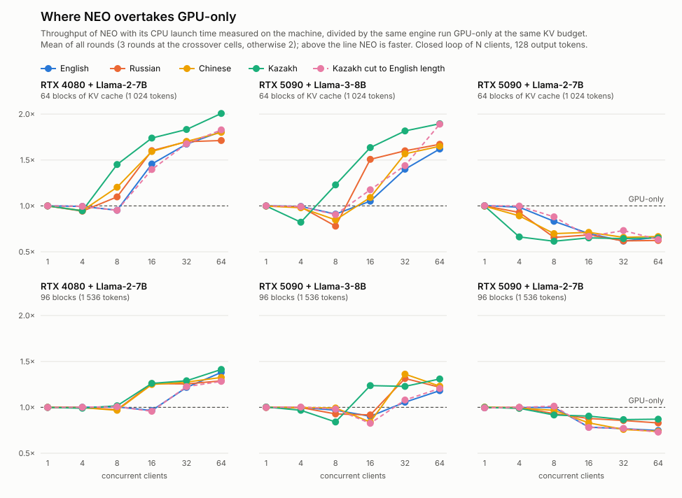
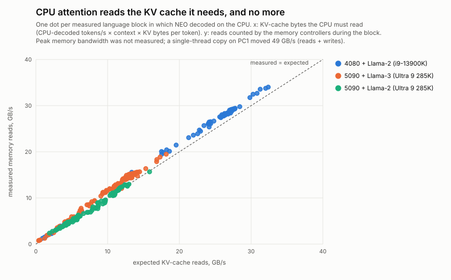

# Stage 2 report: CPU+GPU serving under load (NEO)

**Status: 20 November 2026.** Stage 2 is measured and analysed. The machines were released on 20 November; all raw runs, journals, profiles and calibrations are archived (see [Data and reproduction](#data-and-reproduction)). Stage 1 (one laptop, llama.cpp) is in the [current report](current-report.md).

## Main findings

1. **Under memory pressure, CPU+GPU serving beats GPU-only by up to 2.0×.** NEO, which moves part of the decode attention and its KV cache to the CPU, outperforms the same engine run GPU-only on an RTX 4080 with Llama-2-7B (up to 2.01×) and on an RTX 5090 with Llama-3-8B (up to 1.90×), once the GPU KV cache holds 64–96 blocks and enough clients wait. This is the first hybrid win in the project: stage 1 never saw one.
2. **Language moves the crossover.** Kazakh needs half or a quarter of the load English needs before NEO pays off: 8 against 16 clients (4080, 64 blocks), 16 against 32 (4080, 96 blocks), 8 against 32 (5090 + Llama-3, 64 blocks), 16 against 64 (5090 + Llama-3, 96 blocks). Russian and Chinese fall between. **RQ1: yes.**
3. **The shift is explained by token length.** No language crosses later than a shorter one in any setup, and when the tokenizer changes which language is longer, the crossover order changes with it. Kazakh cut to the English token length crosses where English does in three of the four winning setups; in the fourth it is one step earlier, decided by a single round (see below). **RQ2: a length-only policy is sufficient** in everything measured here.
4. **The same GPU can win or lose depending on the model's KV layout.** On the RTX 5090 Llama-2-7B never gains from the CPU (NEO is 10–38% slower whenever it uses it), but Llama-3-8B gains up to 1.9×. The CPU reads the same ~12 GB/s in both cases; Llama-3's grouped-query attention stores 4× fewer KV bytes per token, so the CPU decodes 4× more tokens for the same traffic.
5. **The win costs per-token latency, not responsiveness.** At 32 clients the time to first token falls from 12.9 s to 0.26 s (4080, English), but every generated token takes 82 ms instead of 30 ms. Mean request latency still improves (16.7 → 10.6 s).
6. **Where NEO wins it also saves energy**: 0.74× (4080) and 0.59× (5090 + Llama-3) of the GPU-only energy per generated token, GPU plus CPU package. Where it loses, it costs 1.13×.
7. **The scheduler's default constant hides all of this.** NEO as shipped assumes 0.8 ms of CPU launch overhead per layer; on these machines it is 0.17–0.18 ms. With the shipped value NEO never moves work to the CPU, and its best result anywhere is +2.9%.

**Limits of the win.** It exists only while the KV budget is the bottleneck. Given the whole GPU, GPU-only serves 3,400–3,800 tokens/s on the 5090 at 64 clients, four to five times NEO's best result at a capped budget; on the 4080, vLLM with free memory is 19–24% faster than NEO at 64 blocks. The constrained budgets stand in for a model or context that barely fits, which is the regime the research questions are about.

## Research questions

As approved on 14 November 2026:

- **RQ1:** Under which conditions does CPU+GPU execution outperform GPU-only, and does the request language shift that boundary?
- **RQ2:** Is a policy that knows only the sequence length sufficient to choose the configuration?

## Where NEO overtakes GPU-only



Smallest number of clients from which NEO wins by more than 5% in every round, and keeps winning at every higher load. Smaller differences are ties: the [pinning check](#a-methodology-error-found-before-measuring) showed NEO's throughput moves by up to ~10% with thread placement, so nothing below 5% is claimed.

| Setup | KV budget | English | Russian | Chinese | Kazakh | Kazakh cut to EN length |
|---|---|---:|---:|---:|---:|---:|
| | *mean input tokens* | *109* | *184* | *211* | *284* | *109* |
| RTX 4080 + Llama-2-7B | 64 blocks | 16 | 8 | 8 | **8** | 16 |
| | 96 blocks | 32 | 16 | 16 | **16** | 32 |
| | *mean input tokens* | *93* | *155* | *118* | *301* | *93* |
| RTX 5090 + Llama-3-8B | 64 blocks | 32 | 16 | 32 | **8** | 16 |
| | 96 blocks | 64 | 32 | 32 | **16** | 64 |
| RTX 5090 + Llama-2-7B | any budget | never | never | never | never | never |

Gain at the crossover and at 64 clients (NEO / GPU-only, mean of rounds):

| Setup | KV budget | English | Russian | Chinese | Kazakh | Kazakh cut |
|---|---|---|---|---|---|---|
| 4080 + Llama-2 | 64 blocks | 1.46 → 1.81 | 1.10 → 1.71 | 1.20 → 1.80 | 1.45 → **2.01** | 1.40 → 1.83 |
| | 96 blocks | 1.22 → 1.38 | 1.26 → 1.29 | 1.25 → 1.33 | 1.26 → 1.41 | 1.23 → 1.28 |
| 5090 + Llama-3 | 64 blocks | 1.40 → 1.62 | 1.51 → 1.67 | 1.57 → 1.65 | 1.23 → 1.90 | 1.18 → 1.89 |
| | 96 blocks | 1.18 | 1.32 → 1.22 | 1.36 → 1.23 | 1.24 → 1.31 | 1.21 |

Three things to read from the figure:

- **Before the crossover NEO is slightly slower**, typically 2–6% on the 4080 and up to 22% on the 5090 + Llama-3 (Russian, 8 clients, 64 blocks). This is the cost of the CPU path when the GPU-only engine is not yet swapping requests out.
- **The tokenizer reorders the languages, and the crossover follows it.** Llama-2 makes Chinese longer than Russian (211 against 184 tokens); Llama-3 makes it shorter (118 against 155). On the 5090 + Llama-3 at 64 blocks Russian crosses at 16 clients and Chinese only at 32. The same text changed places because its token count did, which is the strongest single piece of evidence for RQ2.
- **At 128 blocks and more nothing wins on the 5090**: the GPU-only engine no longer runs out of KV space at 64 clients. Single cells reach 1.07–1.11×, but not in every round.

### Why language shifts the boundary

GPU-only NEO swaps requests out once their KV cache no longer fits; NEO keeps them running by decoding part of the batch on the CPU. A Kazakh request holds 1.7× the KV cache of the same English request by the end of its output (284 + 128 against 109 + 128 tokens with Llama-2; 1.9× with Llama-3), so the GPU runs out of space at roughly half the number of clients, and the hybrid starts paying one load step (2×) earlier. Cutting Kazakh to the English token count removes the difference: in three of the four winning setups the cut Kazakh crosses at the same load as English. In the fourth (5090 + Llama-3, 64 blocks) the two are level at 16 clients in rounds 1 and 2 (1.12 and 1.05 for English, 1.09 and 1.08 for cut Kazakh) and differ only in round 3 (0.99 against 1.36), where NEO's scheduler took a different path; by the 5% rule English is a tie there and crosses at 32. Nothing in the data points to script, morphology or vocabulary mattering on their own; the token count explains every shift.

## Why the 5090 needs Llama-3



The memory controllers were sampled every second during every measured block. During CPU decode, the traffic they count follows the KV-cache bytes that the CPU-decoded tokens must read, 2–12% above it (the rest of the system also reads memory):

| Setup | Blocks with CPU decode share > 0.4 | Measured reads, GB/s | Expected KV reads, GB/s | CPU package, W |
|---|---:|---:|---:|---:|
| 4080 + Llama-2 (i9-13900K) | 68 | 25.2 (max 34.0) | 23.5 | 111 |
| 5090 + Llama-3 (Core Ultra 9 285K) | 102 | 12.8 (max 19.5) | 11.4 | 50 |
| 5090 + Llama-2 (Core Ultra 9 285K) | 24 | 12.0 (max 15.7) | 11.8 | 43 |

On the 5090 machine the CPU reads about 12 GB/s with either model. Llama-2-7B stores 512 KiB of KV cache per token; Llama-3-8B, with 8 KV heads instead of 32, stores 128 KiB. For the same traffic the CPU therefore finishes four times as many Llama-3 tokens, which is enough to keep up with an RTX 5090. With Llama-2 it is not, and NEO's CPU share only slows the GPU down. The 4080 is slow enough that the i9-13900K keeps up even with Llama-2.

**What limits the CPU is open.** Peak memory bandwidth was not measured, and the memory speed set in the BIOS was not recorded. Both machines have 128 GB of DDR5 in four 32 GB modules on two channels (125 GiB visible to the system). With two modules per channel, Intel specifies roughly DDR5-4000 to 4800 for these processors (higher if the board applies an XMP profile), which puts the theoretical peak at about 64–90 GB/s per machine (transfer rate × 16 bytes). Against that estimate:

- **PC1** reads 12–13 GB/s on average during CPU decode, at most 19.5 GB/s: under a third of the lowest estimate, and less than a single thread moved in a copy test on the same machine (49 GB/s reads plus writes, about half of it reads). The CPU path on PC1 is very unlikely to be bandwidth-bound.
- **PC2** reads 25 GB/s on average, at most 34 GB/s: about 40–55% of the theoretical estimate. Sustained bandwidth is usually well below the theoretical peak, so on PC2 bandwidth may be part of the limit.

So the bandwidth explanation is unlikely on PC1 and undecided on PC2; compute or core latency are the alternatives. This is an estimate from the hardware configuration, not a measurement, and it is the main [future-work](#future-work) item.

## What the throughput gain costs

Means at 64 blocks and 32 clients:

| Setup | Language | System | Tokens/s | Mean latency, s | p95 latency, s | Time to first token, s | Time per output token, ms |
|---|---|---|---:|---:|---:|---:|---:|
| 4080 + Llama-2 | English | GPU-only | 216 | 16.7 | 19.2 | 12.93 | 30 |
| | | NEO | **361** | **10.6** | **14.7** | **0.26** | 82 |
| | Kazakh | GPU-only | 101 | 35.9 | 41.9 | 32.39 | 27 |
| | | NEO | **185** | **20.1** | **27.5** | **0.47** | 154 |
| 5090 + Llama-3 | English | GPU-only | 466 | 7.8 | 9.5 | 5.81 | 16 |
| | | NEO | **653** | **5.8** | **7.1** | **0.13** | 44 |
| | Kazakh | GPU-only | 182 | 19.9 | 23.1 | 18.06 | 14 |
| | | NEO | **330** | **11.2** | **15.0** | **0.23** | 86 |
| 5090 + Llama-2 | English | GPU-only | **466** | **7.7** | **8.9** | 5.96 | **14** |
| | | NEO | 287 | 12.9 | 26.7 | **0.13** | 100 |

GPU-only spends most of a request waiting in the queue, then generates fast. NEO admits requests almost immediately and generates each token more slowly, because part of the batch waits for the CPU. Which matters more depends on the service: a chat interface feels the first-token time, a reader of streamed text feels the time per token. Both are reported; the throughput gain alone does not show this trade-off.

## Energy

Energy per generated token, from GPU board power (nvidia-smi) plus CPU package power (RAPL), integrated over each measured block. DRAM, fans and the power supply are not included.

| Setup | Blocks where | Pairs | Throughput, NEO / GPU-only | Energy per token, NEO / GPU-only |
|---|---|---:|---:|---:|
| 4080 + Llama-2 | NEO faster by > 10% | 60 | 1.50 | **0.74** |
| | within 10% | 60 | 0.99 | 1.03 |
| 5090 + Llama-3 | NEO faster by > 10% | 49 | 1.44 | **0.59** |
| | within 10% | 212 | 1.00 | 0.98 |
| | NEO slower by > 10% | 39 | 0.82 | 1.00 |
| 5090 + Llama-2 | within 10% | 188 | 0.99 | 1.00 |
| | NEO slower by > 10% | 112 | 0.79 | **1.13** |

Where NEO decodes on the CPU, the CPU package draws 50 W more on PC2 and 17 W more on PC1, while the GPU draws 30 W less on the 4080 and 120–130 W less on the 5090 (busy 62–79% of the time instead of 92–98%), and the work finishes sooner. Saving energy is a by-product of being faster here, not a separate effect.

## Setup

| | PC1 | PC2 |
|---|---|---|
| GPU | RTX 5090, 32 GB | RTX 4080, 16 GB |
| CPU | Intel Core Ultra 9 285K | Intel Core i9-13900K |
| System | CachyOS live from USB, environment in RAM | same |
| Models | Llama-2-7B, Llama-3-8B (fp16) | Llama-2-7B (fp16) |
| Calibrated CPU launch time per layer | 0.178 ms (Llama-2), 0.184 ms (Llama-3) | 0.170 ms |

- **Engines.** NEO at the authors' code plus six local patches (`tools/neo-patches/0001–0006` in the context repository; the last makes the launch time a setting). Both machines ran the same source tree (`a51ea61`). vLLM 0.34.0 as the external reference.
- **Systems compared.** `neo_base`: NEO with `--always-use-gpu`, i.e. GPU-only at the same KV budget. `neo_tuned`: NEO with the launch time calibrated on that machine. `neo`: NEO as shipped (0.8 ms), at 64 blocks only. `vllm`: on PC2 at 64 and 96 blocks and with free memory.
- **Workload.** FLORES-200 dev: 20 passages of four consecutive sentences in English, Russian, Kazakh, Simplified Chinese, plus Kazakh cut to the English token length of the same passage. Bare-text continuation, greedy, exactly 128 output tokens.
- **Load.** Closed loop of 1, 4, 8, 16, 32 or 64 clients, at least 32 requests and 4 waves per language block after 2 warm-up waves; a fresh server start for every cell; languages in a shuffled order within each start.
- **KV budgets.** 64, 96, 128, 192 blocks of 16 tokens and free memory (PC1); 64 and 96 blocks (PC2). 8 OpenMP threads for CPU attention, no thread pinning (as the authors run it).
- **Rounds.** 2 rounds for every cell. Cells next to a crossover, where the gain was comparable to the round spread, got a third round as a separate run with a new seed (3042), which also draws a new passage and language order.
- **Journals**, all in UTC and aligned to every language block: `nvidia-smi dmon` every second (power, SM clock, utilisation, PCIe traffic, power and thermal violations); CPU clocks and temperatures every 5 s; memory-controller read and write counters and RAPL package power every second (checked against a copy of known size: 49.2 GB/s by numpy, 50.2 GB/s by the counters).

## Measurements

| Run | Machine | Model | Cells | Language blocks | Requests | Failures |
|---|---|---|---:|---:|---:|---:|
| [serving-llama2-pc1-v3](results/serving-llama2-pc1-v3/report.md) | PC1 | Llama-2-7B | 132 | 660 | 21,120 | 0 |
| [serving-llama2-pc2-v3](results/serving-llama2-pc2-v3/report.md) | PC2 | Llama-2-7B | 96 | 480 | 15,360 | 0 |
| [serving-llama2-pc2-v3-r3](results/serving-llama2-pc2-v3-r3/report.md) | PC2 | Llama-2-7B | 8 | 40 | 1,280 | 0 |
| [serving-llama3-pc1-v1](results/serving-llama3-pc1-v1/report.md) | PC1 | Llama-3-8B | 132 | 660 | 21,120 | 0 |
| [serving-llama3-pc1-v1-r3](results/serving-llama3-pc1-v1-r3/report.md) | PC1 | Llama-3-8B | 8 | 40 | 1,280 | 0 |
| **Total** | | | **376** | **1,880** | **60,160** | **0** |

Requests are the measured minimum (32 per block); waves at higher loads send more. Warm-ups, calibration and probes are excluded. Every response had exactly 128 tokens.

**Repeatability.** The median range between rounds is 0.3–0.5% of the mean, the 90th percentile 2.6–4.2%. The large ranges (up to 36%) are all NEO at 64–96 blocks near the crossover, where the scheduler decides differently from round to round; those are the cells that got the third round.

## Validity checks

- **The GPU-only baseline is fair.** vLLM and GPU-only NEO agree within 3% at both budgets on PC2 (median ratio 1.00 at 64 blocks, 1.03 at 96), so the hybrid is compared with a competitive engine, not a crippled one.
- **NEO's CPU path computes the same model.** For Llama-3, which NEO does not list, a check before the run compared the first greedy tokens of NEO's GPU path, its CPU path and vLLM: all 17 generated tokens agreed. Llama-3-8B was used instead of 3.1 because NEO ignores the 3.1 rope scaling.
- **No throttling.** No thermal-violation event in any block; power violation 0.0–0.14% of the time; SM clocks steady at 2,900 MHz (5090) and 2,735 MHz (4080).
- **Every cell records the server's CPU affinity**, so a placement error like the one below cannot pass unnoticed again.

### A methodology error found before measuring

The first series pinned the OpenMP threads with `GOMP_CPU_AFFINITY=0-7`. libgomp applies that list to the thread that starts it, and every thread and Ray worker inherited the binding: the whole NEO server ran on core 0. The error was found on 19 November before any data was analysed. Both series were stopped and set aside, NEO was profiled and calibrated again, and the measured series (v3) runs unpinned, as the authors run it. The control cell (64 blocks, Kazakh, 32 clients) moved from 204.8 to 185.1 tokens/s on PC2 and from 128.7 to 130.5 on PC1. That ~10% sensitivity is why gains below 5% are reported as ties.

## Comparison with stage 1

Stage 1 split a model's layers between CPU and GPU (llama.cpp) and never beat GPU-only when the model fitted. Stage 2 splits the work differently: the weights stay on the GPU and the CPU takes over attention over part of the KV cache, which is the part that grows with the input language. That is why language could not shift the boundary in stage 1 and does in stage 2.

## Limitations

- **Two machines, two GPU classes, two models**, one KV block size and one output length. The crossover loads are specific to these; the order by token length is the general result.
- **Budgets are artificial.** KV space was capped to create memory pressure on GPUs that had plenty. A model that genuinely fills the GPU would also lose compute headroom, which is not modelled.
- **8 CPU threads only.** The thread count was not varied after the pinning fix (see future work).
- **No reference measurement of memory bandwidth.** The journals record how much memory traffic the CPU used, not how much the memory could deliver; the peak is estimated from the module configuration, and the DIMM speed was not recorded.
- **Energy excludes DRAM and the rest of the system.**
- **Response fingerprints are not comparable across engines**: vLLM hashes the response text and NEO the token IDs. Correctness was checked separately (above). Within NEO, batch composition changes fp16 rounding, so the same passage can produce different but valid continuations; GPU-only NEO shows the same.
- **The cloud copy of the runs keeps the abandoned pinned series** (`serving-llama2-pc1-v2`) next to the measured ones; it is excluded from every table here.

## Future work

1. **What limits the CPU path, and do more threads help?** The journals show the CPU reading the KV bytes it needs and no more. On PC1 that is below what one copying thread moves. Sweep 8, 16 and 24 threads on the control cells with the memory journal running: if the traffic and the crossover move with the thread count, the CPU path is compute- or latency-bound and the 5090 + Llama-2 result could flip.
2. **A length-only scheduler.** RQ2 says the token count is enough; the next step is a policy that picks NEO or GPU-only from the queued token count and is tested on mixed-language traffic.
3. **A model that really does not fit**, instead of a capped KV budget.

## Data and reproduction

- **Tables** in this repository: per-run `rounds.csv`, `cells.csv`, `crossovers.json` and `report.md` under `docs/results/serving-*/`; the cross-run tables `ratios.csv`, `crossovers.csv`, `journals.csv`, `energy.csv`, `latency.csv`, `journal-blocks.csv` and `summary.json` under `docs/results/stage2/`.
- **Raw runs, journals, NEO profiles and calibrations**: the private repository `pdc-lab-runs`, with a second copy on the laptop.
- **Regenerating everything from the raw runs:**

```sh
uv run pdc-research analyze-serving --run <raw run dir> --output docs/results/<run>   # per run
python3 scripts/align_journals.py <directory holding pc1/ and pc2/ raw copies>          # per-block journal windows
python3 scripts/stage2_analysis.py                                                    # cross-run tables
python3 scripts/plot_stage2.py                                                        # figures
```

Each run directory carries a fingerprint (`metadata.json`): engine version, NEO commit, SHA-256 of the model files, the NEO library and every profile file, the workload manifest and the full machine and experiment configuration.
